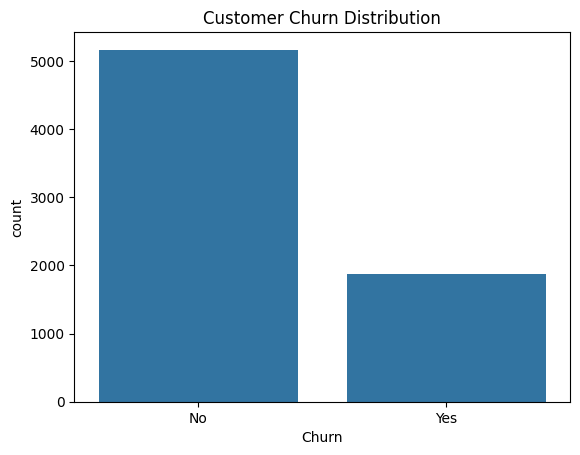
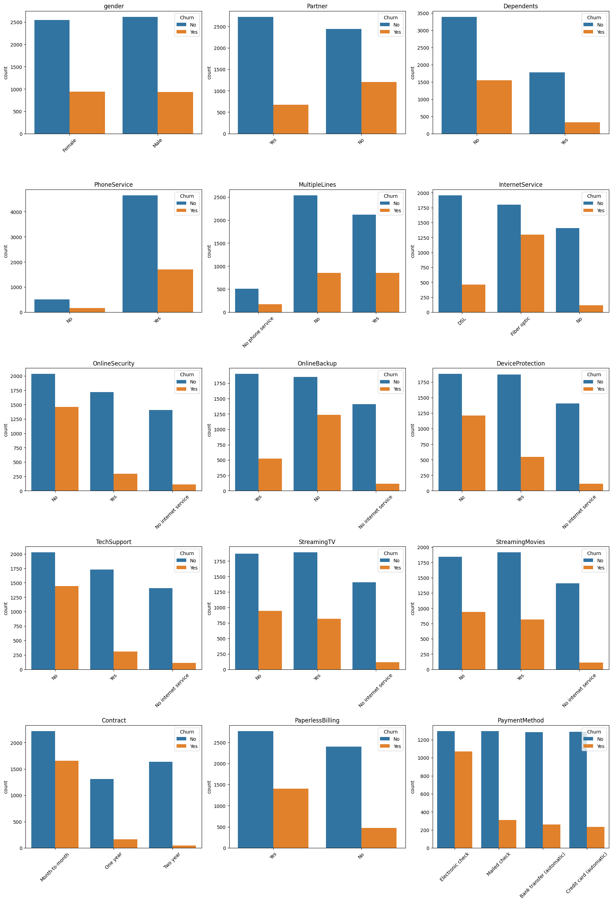
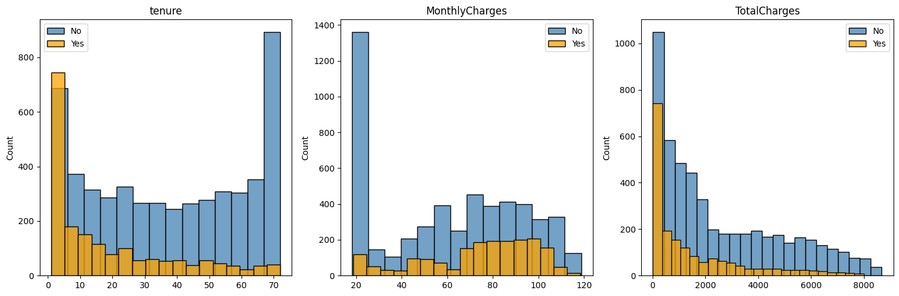
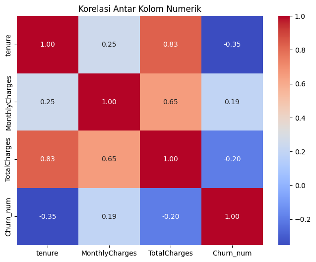
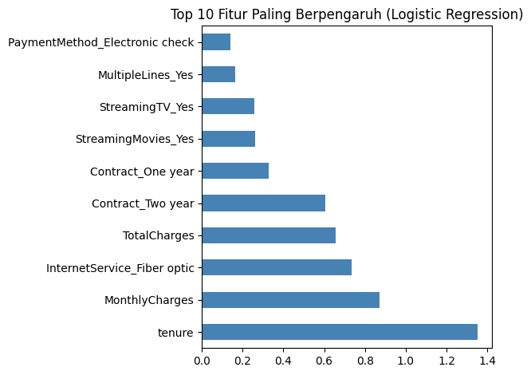
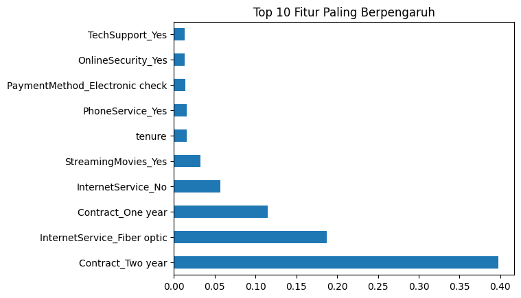

# 📊 Telco Customer Churn Prediction

## Business Problem
Bagaimana perusahaan telekomunikasi dapat memprediksi pelanggan yang akan churn (berhenti berlangganan) dan mengambil langkah pencegahan yang tepat?

## Dataset
- **Source**: [Kaggle - Telco Customer Churn](https://www.kaggle.com/datasets/blastchar/telco-customer-churn)
- **Size**: 7.043 pelanggan, 21 kolom
- **Target**: `Churn` (Yes/No)

## Tools & Technologies
Python · Pandas · NumPy · Seaborn · Matplotlib · Scikit-learn · Tableau

## Links
- 📓 [Kaggle Notebook](https://www.kaggle.com/code/zx1700/da01-telco-ccp) <!-- Ganti dengan link Kaggle kamu -->
<!-- 📊 [Tableau Dashboard](#)  Ganti dengan link Tableau Public kamu -->

---

## Analysis & Results

### 1. Data Overview
- **7.043** pelanggan setelah cleaning
- **Churn rate ~26.5%** — sekitar 1 dari 4 pelanggan berhenti berlangganan
- Missing value ditemukan pada `TotalCharges` (11 baris, dikonversi ke numerik)

### 2. Distribusi Churn

Mayoritas pelanggan tidak churn (73.5%), namun **26.5% churn rate** cukup tinggi dan berdampak signifikan terhadap revenue.

### 3. Analisis Churn per Fitur

Analisis visual menunjukkan pola churn berdasarkan berbagai fitur pelanggan:

Temuan utama:
- Pelanggan **month-to-month** memiliki churn rate **~42%** (tertinggi)
- **Tenure rendah** (0-12 bulan) = risiko churn tertinggi
- Pelanggan **tanpa tech support** dan **tanpa online security** lebih cenderung churn

### 4. Correlation Heatmap

### 5. Feature Importance

#### Logistic Regression

#### Random Forest / XGBoost

---

## Key Findings
1. **Churn rate 26.5%** — 1 dari 4 pelanggan berhenti berlangganan
2. **Kontrak month-to-month** = faktor risiko churn terbesar
3. **Tenure rendah** (0-12 bulan) = periode paling kritis
4. **Monthly charges tinggi** + kontrak pendek = kombinasi paling berisiko
5. **Tanpa tech support & online security** meningkatkan kemungkinan churn

## Recommendations
- **Retention Program**: Fokus pada pelanggan month-to-month dengan tenure < 12 bulan
- **Bundle Offers**: Tawarkan paket tech support + online security untuk mengurangi churn
- **Contract Incentive**: Berikan diskon untuk upgrade ke kontrak 1-2 tahun
- **Early Warning System**: Gunakan model prediksi untuk mendeteksi pelanggan berisiko churn

---

*Project ini merupakan bagian dari portfolio Data Analyst.*
